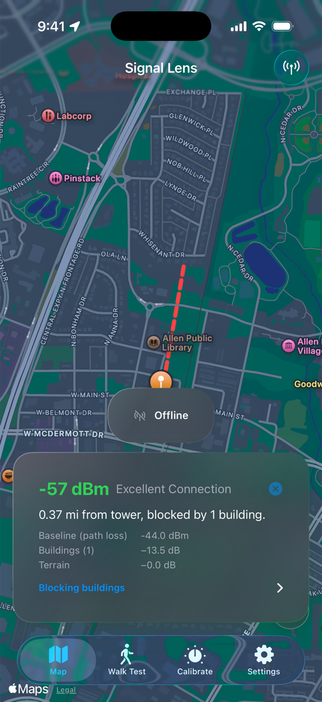

# Signal Lens

**An iPhone app that estimates cellular signal strength and explains what is in the way.**

Tap a point on the map to estimate signal strength from tower distance, buildings, and terrain. The prediction shows the estimated loss for each component, so you can distinguish a long path from a nearby building obstruction.

   [](https://github.com/yajatp/signal-lens/actions/workflows/backend-tests.yml)

<p align="center">
  
</p>

*The simulator uses a synthetic tower and obstruction for this preview. The prediction is a model estimate. The Offline indicator refers to the separate cellular probe.*

## What you can do

| View | What it shows |
|---|---|
| Map | Tower locations, a tap-to-predict map, and separate distance, building, and terrain penalties |
| Walk Test | A time series of model predictions and observations from the phone’s connectivity probe |
| Calibrate | A place to record an RSRP reading from Field Test Mode when the device makes it available |

## How it works

```
predicted_dbm = path_loss_baseline − building_obstruction_penalty − terrain_penalty
```

1. **Path loss** — log-distance model anchored to Friis free-space loss at a reference distance, with an environment-tuned exponent.
2. **Building LOS ray trace** — the 3D segment from your phone (~1.5 m) to the tower antenna (~30 m) is intersected against real OSM building footprints (PostGIS spatial query); any building whose roof pierces the line adds a flat attenuation penalty.
3. **Terrain shadowing** — USGS 3DEP elevations are sampled along the path; terrain that rises into the line adds a knife-edge-style penalty.

Walk tests and manual calibration can pair predictions with observations. Those records are the input for a planned residual calibration model.

## Try the backend

Requires Python 3.12 and a running PostgreSQL instance with PostGIS installed. The local PostgreSQL user needs permission to create the PostGIS extension.

```bash
git clone https://github.com/yajatp/signal-lens.git
cd signal-lens/backend
python3 -m venv .venv
source .venv/bin/activate
python -m pip install -r requirements.txt
createdb signal_lens
cp .env.example .env
python -m scripts.init_db
```

Set `OPENCELLID_API_KEY` in `.env` and run the regional import before requesting a prediction. The importer fetches towers and building footprints for Allen and McKinney, Texas.

```bash
python -m scripts.seed_allen_mckinney
python -m uvicorn app.main:app --reload
```

Open the [local API explorer](http://127.0.0.1:8000/docs) or query a point inside the seeded region.

```bash
curl 'http://127.0.0.1:8000/predict?lat=33.1032&lon=-96.6706'
```

The physics unit tests run with no database or data-provider keys.

```bash
python -m pytest tests/
```

## Run the iPhone app

On macOS, install Xcode and [XcodeGen](https://github.com/yonaskolb/XcodeGen). From the repository root, generate the project and open it.

```bash
cd ios
xcodegen generate
open SignalLens.xcodeproj
```

Start the backend first and use an iPhone simulator for the map and prediction workflow. To use a physical iPhone, run the backend with `--host 0.0.0.0` on your local development network and set the Mac’s LAN URL in the app’s Settings. Use a physical device with cellular service for the connectivity probe and manual Field Test calibration.

## Data and limitations

- Tower records come from [OpenCelliD](https://opencellid.org/), building footprints and height tags from [OpenStreetMap](https://www.openstreetmap.org/copyright), and elevations from [USGS 3DEP](https://www.usgs.gov/3d-elevation-program).
- Predictions are model estimates. The cellular probe derives a proxy from latency and throughput. Manual Field Test readings can supply calibration data where available.
- Building heights fall back to floor counts or defaults when tags are missing. The model applies a simplified attenuation penalty rather than simulating every reflection or material.
- The default seed covers Allen and McKinney. Coverage elsewhere depends on the tower and building data loaded.

## Repository guide

| Path | Contents |
|---|---|
| [backend/](backend/) | FastAPI, PostGIS, ingestion scripts, and physics tests |
| [ios/](ios/) | SwiftUI client, network probe, and walk-test recorder |
| [Project spec](docs/signal-lens-project-spec.md) | Model assumptions, implementation notes, and roadmap |
